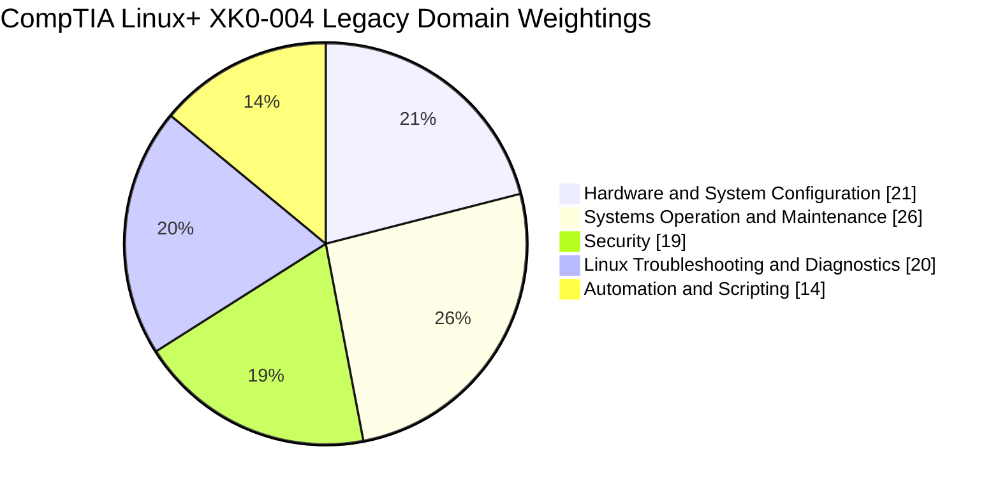
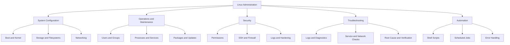
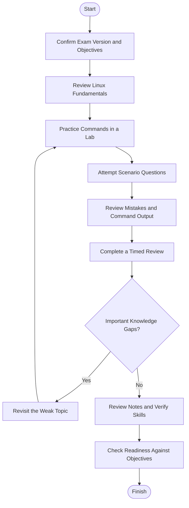
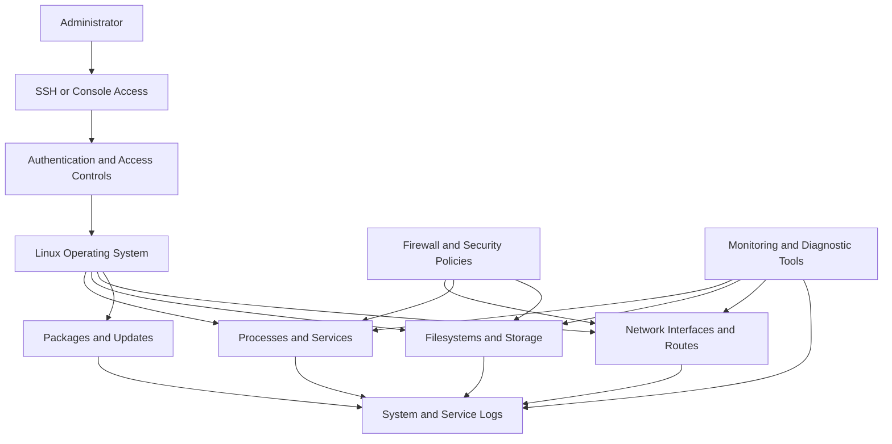
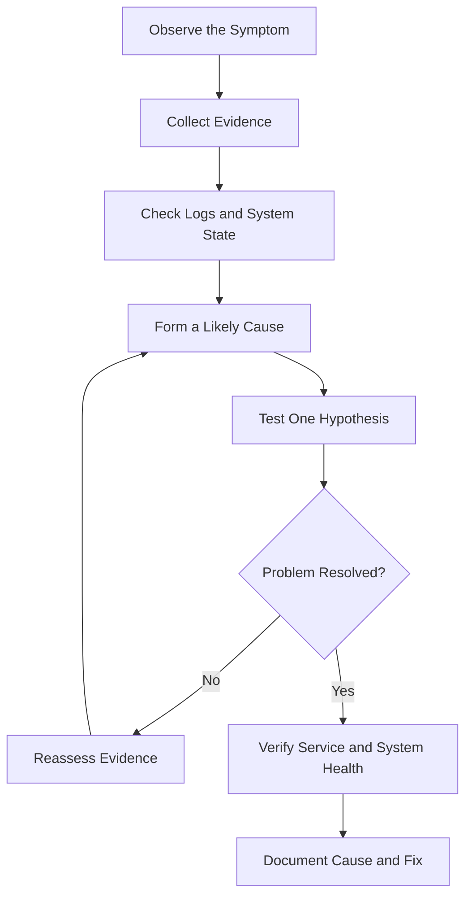
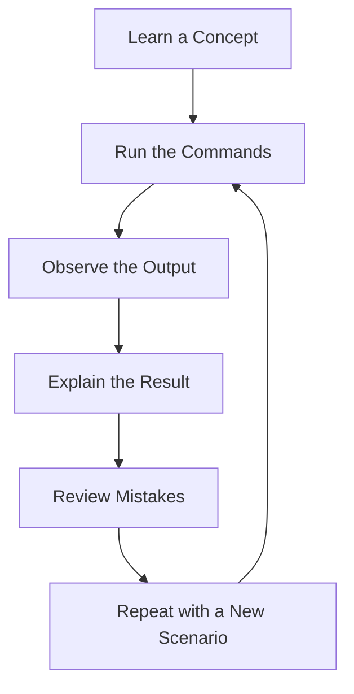
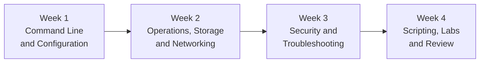

# CompTIA Linux+ XK0-004 Study Guide

A practical, archived study resource for **CompTIA Linux+ XK0-004**, covering Linux system configuration, operations and maintenance, security, troubleshooting, automation, and scripting.

This repository organizes the legacy exam objectives into a structured study plan with Mermaid diagrams, practical lab ideas, original review questions, and a troubleshooting roadmap.

> **Exam-version notice:** XK0-004 is an older Linux+ exam version. Check the current exam version and availability on the [official CompTIA Linux+ page](https://www.comptia.org/en-us/certifications/linux) before using this repository to plan a certification attempt. The material here is intended for legacy-objective review and Linux skills development, not as a substitute for the current exam blueprint.

For additional independent study materials, visit [CertsGate](https://certsgate.com/). Any relevant practice questions or study guides should be used alongside official documentation and hands-on work.

---

## Table of Contents

- [About Linux+ XK0-004](#about-linux-xk0-004)
- [Who Can Use This Guide?](#who-can-use-this-guide)
- [Legacy Exam Details](#legacy-exam-details)
- [Official XK0-004 Domain Weightings](#official-xk0-004-domain-weightings)
- [Linux Administration Skills Map](#linux-administration-skills-map)
- [Preparation Flowchart](#preparation-flowchart)
- [Linux Server Architecture](#linux-server-architecture)
- [Linux Troubleshooting Workflow](#linux-troubleshooting-workflow)
- [Circular Study Cycle](#circular-study-cycle)
- [Step-by-Step Study Plan](#step-by-step-study-plan)
- [Suggested Four-Week Roadmap](#suggested-four-week-roadmap)
- [Practice Questions](#practice-questions)
- [Hands-On Linux Labs](#hands-on-linux-labs)
- [Common Preparation Mistakes](#common-preparation-mistakes)
- [Career and Skills Relevance](#career-and-skills-relevance)
- [Frequently Asked Questions](#frequently-asked-questions)
- [Official and Technical Resources](#official-and-technical-resources)
- [About CertsGate](#about-certsgate)
---

## About Linux+ XK0-004

CompTIA Linux+ XK0-004 was designed to assess practical skills for configuring, monitoring, supporting, securing, and troubleshooting Linux systems. Its objectives emphasize hands-on system administration rather than command memorization alone.

This legacy exam version covers five broad areas:

1. Hardware and system configuration.
2. Systems operation and maintenance.
3. Security.
4. Linux troubleshooting and diagnostics.
5. Automation and scripting.

These subjects remain relevant to many Linux administration tasks, including server maintenance, access management, service troubleshooting, storage administration, network configuration, and routine automation.

**Important distinction:** Linux skills can remain useful after an exam version retires, but the XK0-004 blueprint should not be assumed to match the current CompTIA Linux+ exam.

## Who Can Use This Guide?

This repository may be useful for:

- Learners reviewing legacy Linux+ XK0-004 objectives.
- Linux administrators strengthening foundational system skills.
- IT support professionals moving toward server administration.
- Students learning Linux command-line operations and troubleshooting.
- Candidates comparing older exam objectives with their existing Linux knowledge.

The published XK0-004 objectives recommended approximately **9–12 months of hands-on experience** configuring, monitoring, and supporting Linux servers. This was guidance for that exam version, not a universal prerequisite for learning Linux or a statement of current exam eligibility.

---

## Legacy Exam Details

The following information comes from the published CompTIA Linux+ XK0-004 objectives, version 5.0.

| Item | XK0-004 published detail |
|---|---|
| Certification | CompTIA Linux+ |
| Exam code | XK0-004 |
| Maximum questions | 90 |
| Question types | Multiple-choice and performance-based |
| Exam duration | 90 minutes |
| Passing score | 720 on a scale of 100–900 |
| Recommended experience | 9–12 months of hands-on Linux server experience |

These are **historical XK0-004 details**. Do not assume they apply to a newer Linux+ exam version. Check the current [CompTIA Linux+ certification page](https://www.comptia.org/en-us/certifications/linux) for current exam information.

---

## Official XK0-004 Domain Weightings

The published XK0-004 objectives specify the following distribution.

| Domain | Published weight |
|---|---:|
| 1.0 Hardware and System Configuration | 21% |
| 2.0 Systems Operation and Maintenance | 26% |
| 3.0 Security | 19% |
| 4.0 Linux Troubleshooting and Diagnostics | 20% |
| 5.0 Automation and Scripting | 14% |
| **Total** | **100%** |

These percentages belong specifically to the XK0-004 objectives. They are included for historical study and must not be treated as the domain weights of a current Linux+ exam.

### XK0-004 domain chart

### Domain 1.0 — Hardware and System Configuration (21%)

Review the basic components and configuration tasks needed to bring Linux systems online and keep them working.

Study areas include:

- Linux boot process, boot loaders, and boot options.
- Kernel modules and related configuration.
- Network connection parameters and troubleshooting tools.
- Storage devices, partitions, filesystems, and filesystem repair.
- Linux filesystem hierarchy and device mapping.
- Hardware configuration and system-level diagnostics.

**Practice idea:** Build a Linux virtual machine, inspect its boot configuration, identify storage devices, and record its network settings.

### Domain 2.0 — Systems Operation and Maintenance (26%)

This is the largest domain in the legacy blueprint.

Focus on:

- User and group administration.
- Files, directories, ownership, permissions, and quotas.
- Process and service management.
- Software installation and package management.
- System monitoring and scheduled maintenance.
- Network services and system configuration.
- Storage management, including logical volume concepts.
- Backup, recovery, and routine administrative tasks.

**Practice idea:** Create a user, assign group membership, configure directory permissions, manage a service, and verify the results using Linux commands.

### Domain 3.0 — Security (19%)

Understand how to apply Linux security controls and investigate common security-related configuration problems.

Review:

- User authentication and authorization.
- File and directory permissions.
- Secure remote administration.
- Firewall configuration and network protection.
- System hardening and security updates.
- Logging, auditing, and security monitoring.
- Encryption and protection of sensitive information.

**Practice idea:** Create a least-privilege user account, configure SSH access safely in a test environment, and inspect authentication logs.

### Domain 4.0 — Linux Troubleshooting and Diagnostics (20%)

Troubleshooting requires a structured process: identify symptoms, collect evidence, test likely causes, apply a controlled fix, and verify recovery.

Review:

- Boot failures and kernel-related problems.
- Service failures and process issues.
- Network connectivity and name-resolution problems.
- Filesystem capacity and storage errors.
- Permission and authentication failures.
- Log inspection and diagnostic utilities.
- Validation after corrective changes.

**Practice idea:** Intentionally stop a test service or fill a disposable test filesystem with harmless sample files, diagnose the issue, restore normal operation, and document the steps.

### Domain 5.0 — Automation and Scripting (14%)

Learn how to automate repetitive administration tasks and reduce avoidable manual errors.

Study areas include:

- Shell scripting fundamentals.
- Variables, conditions, loops, and command substitution.
- Exit codes and error handling.
- Text processing and command pipelines.
- Script permissions and execution.
- Scheduled tasks.
- Automation for routine system administration.

**Practice idea:** Write a script that checks disk usage, reports filesystem thresholds, and returns a meaningful exit status.

Use the original objectives document to verify the full list of sub-objectives. The descriptions above are a learning summary, not a complete reproduction of the official blueprint.

---

## Linux Administration Skills Map

The following diagram is an independent conceptual map of Linux administration skills. It is not an official CompTIA exam diagram or an additional weighting chart.

Use the map to connect related concepts. For example, a service failure may involve permissions, configuration files, process status, network dependencies, and logs—not just a single command.

---

## Preparation Flowchart

For legacy-objective study, use the following repeatable process. If your goal is to sit a current certification exam, start by checking the current objectives before following this plan.

The important step is the feedback loop. A missed question should lead to a practical explanation and another attempt, rather than simple memorization of the answer.

---

## Linux Server Architecture

The diagram below shows a simplified Linux server and the relationship between administrators, system services, storage, networking, security controls, and logs.

It is a conceptual learning diagram, not an official CompTIA architecture.

### What to understand

- **Access controls:** Authentication identifies the user, while authorization determines permitted actions.
- **Processes and services:** A service can be installed but still fail because of configuration, permissions, dependencies, or resource problems.
- **Storage:** Filesystem capacity, mount status, ownership, and permissions can affect applications.
- **Networking:** Interfaces, routes, DNS, firewall rules, and service listeners all affect connectivity.
- **Logs and monitoring:** Evidence from multiple system components helps establish the cause of a failure.

---

## Linux Troubleshooting Workflow

Use this sequence when diagnosing a problem in a lab or administrative environment.

Useful diagnostic commands include:

| Task | Example commands |
|---|---|
| Inspect running processes | `ps`, `top` |
| Check service status | `systemctl status` |
| Read system logs | `journalctl` |
| Inspect disk usage | `df -h`, `du -sh` |
| Inspect block devices | `lsblk`, `blkid` |
| Check network addresses | `ip addr` |
| Inspect routes | `ip route` |
| Test name resolution | `getent hosts`, `dig` |
| Inspect listening sockets | `ss -tulpn` |
| Check file permissions | `ls -l`, `stat` |
| Find command locations | `command -v` |

Command availability and options vary by Linux distribution. Use the documentation for the distribution installed in your lab.

---

## Circular Study Cycle

Linux administration is best learned through repeated practice.

For every topic, ask:

1. What does the command change or inspect?
2. What output should I expect?
3. What permissions are required?
4. What could go wrong?
5. How would I verify success?
6. How would I undo a change safely?

These questions help develop transferable administration skills beyond any one exam version.

---

## Step-by-Step Study Plan

### Step 1: Confirm which exam you need

Before studying specifically for Linux+ certification, check the current exam code and objectives on the official [CompTIA Linux+ page](https://www.comptia.org/en-us/certifications/linux).

If you are studying XK0-004 for historical review, label your notes accordingly. If you plan to take a newer exam, map each topic to its current objectives.

### Step 2: Set up a safe Linux lab

Use a virtual machine or another environment where you have permission to make changes. Take a snapshot before experimenting with storage, boot configuration, networking, or access controls.

Keep a notebook containing commands, expected output, observed behavior, and recovery steps.

### Step 3: Build command-line confidence

Practice navigating the filesystem, managing files, viewing text, searching output, inspecting processes, and checking permissions.

Learn what commands do before running them with elevated privileges. Be particularly careful with recursive deletion, filesystem tools, partitioning commands, and changes to boot configuration.

### Step 4: Practice system administration

Work through user management, service control, package updates, storage, network configuration, and log inspection.

Try to complete tasks without copying a command blindly. Explain the purpose of each option and verify the result.

### Step 5: Study security and troubleshooting together

Security and troubleshooting often overlap. A failed service might be caused by permissions, an unavailable dependency, a full filesystem, a firewall rule, or an invalid configuration.

Practice gathering evidence before changing the system. Make one controlled change at a time and document the outcome.

### Step 6: Learn automation by solving a real task

Start with small scripts that report disk usage, check whether a service is active, or summarize log entries. Add input validation, meaningful exit codes, and error handling.

The goal is to make a task repeatable and safer—not simply to write a longer script.

### Step 7: Test and review

Use practice questions to identify gaps, then return to the relevant documentation and lab. Keep track of questions answered incorrectly or by guessing.

For current certification preparation, make sure your final revision checklist follows the current exam objectives rather than relying solely on the legacy XK0-004 blueprint.

---

## Suggested Four-Week Roadmap

This is an independent study suggestion, not an official CompTIA schedule. Adjust it to your existing experience and learning goals.

| Week | Suggested focus | Practical outcome |
|---|---|---|
| 1 | Shell basics, boot concepts, filesystem hierarchy | Command notebook and system inventory |
| 2 | Users, services, packages, storage, networking | Working administration checklist |
| 3 | Permissions, security controls, logs, diagnostics | Troubleshooting records and security review |
| 4 | Shell scripts, integrated lab tasks, review questions | Reusable scripts and a skills-gap list |

If the goal is to pass a current Linux+ exam, use this only as a general Linux learning roadmap and adapt it to the current blueprint.

---

## Practice Questions

These are original educational review questions, not official CompTIA questions or claims about live exam content.

### Question 1: Service troubleshooting

A Linux service fails to start after a configuration change. What is the best initial approach?

A. Reinstall the entire operating system.

B. Inspect the service status and relevant logs, then validate the configuration.

C. Disable all security controls.

D. Delete the service's data directory.

**Correct answer: B**

**Explanation:** Service status and logs provide evidence about the failure. Validate the configuration and dependencies before making changes that could destroy data or introduce new problems.

### Question 2: Filesystem capacity

A server reports that a filesystem is nearly full. Which approach is most appropriate?

A. Delete files from system directories without checking their purpose.

B. Use disk-usage tools to identify where space is consumed and determine what can safely be cleaned up.

C. Change all file permissions to writable.

D. Disable logging permanently.

**Correct answer: B**

**Explanation:** Diagnose the space usage first. Logs, temporary files, application data, and deleted-but-open files can have different causes and remediation steps.

### Question 3: Least privilege

A user needs to read a particular project directory but should not modify its files. What should an administrator do?

A. Give the user unrestricted root access.

B. Apply appropriate ownership, group membership, or access permissions that allow the required read access without unnecessary write access.

C. Make the entire filesystem world-writable.

D. Disable authentication.

**Correct answer: B**

**Explanation:** Least privilege grants the access needed for a task while avoiding unnecessary permissions.

### Question 4: Network diagnostics

A Linux host cannot reach a remote server by hostname. Which action helps distinguish a name-resolution problem from a broader connectivity issue?

A. Immediately reinstall the network stack.

B. Test name resolution and separately inspect the host's address, route, and connectivity.

C. Delete the system logs.

D. Change the user's password.

**Correct answer: B**

**Explanation:** Checking name resolution, addresses, routes, and connectivity helps isolate the failing layer before a corrective change is made.

### Question 5: Shell script reliability

A shell script runs several administrative commands, but it sometimes reports success even when a command fails. What should be improved?

A. Error handling, command-result checks, and meaningful exit statuses.

B. The number of blank lines in the script.

C. The file's display name only.

D. The removal of all diagnostic output.

**Correct answer: A**

**Explanation:** Reliable scripts should detect failures and report their outcome clearly. Depending on the task, they may need explicit exit-code checks, validation, and safe recovery behavior.

### How to use practice questions

- Answer before looking at the explanation.
- Explain why each alternative is unsuitable.
- Reproduce the relevant task in a safe lab.
- Map each mistake to a topic in the objectives.
- Repeat similar tasks without following a step-by-step solution.
- Use timed practice for pacing, but prioritize understanding over memorizing answer patterns.

Third-party practice questions are supplementary learning aids. Do not assume they reproduce the actual exam.

---

## Hands-On Linux Labs

Use a disposable virtual machine or another authorized test environment. Take snapshots before tasks that could disrupt boot, storage, network, or access configuration.

### Lab 1: Users and permissions

**Objective:** Understand Linux identities and filesystem permissions.

Tasks:

1. Create a test user and a project group.
2. Create a project directory and assign appropriate ownership.
3. Configure permissions for the intended users.
4. Test access as the authorized user.
5. Verify the result with `id`, `ls -l`, and `stat`.

**Learning outcome:** Explain how user identity, group membership, ownership, and permission bits affect access.

### Lab 2: Service management

**Objective:** Diagnose and recover from a service problem.

Tasks:

1. Choose a non-critical service in a test VM.
2. Inspect its status with `systemctl`.
3. Review relevant logs using `journalctl`.
4. Stop and restart the service in the lab.
5. Confirm its status and expected behavior.

**Learning outcome:** Use system state and logs to distinguish a running service from one that is installed but failing.

### Lab 3: Storage inspection

**Objective:** Understand storage layout and filesystem usage.

Tasks:

1. Inspect block devices with `lsblk`.
2. Review mounted filesystems using `findmnt` and `df -h`.
3. Use `du` to investigate space consumption in a test directory.
4. Compare filesystem capacity with the size of selected directories.
5. Document a safe cleanup procedure.

**Learning outcome:** Understand the difference between device layout, mounted filesystems, and space consumed by files.

Avoid partitioning or formatting a disk containing important data.

### Lab 4: Network diagnostics

**Objective:** Practice diagnosing a connectivity problem.

Tasks:

1. Inspect interfaces with `ip addr`.
2. Review routes with `ip route`.
3. Check name resolution with `getent hosts`.
4. Inspect listening sockets using `ss`.
5. Compare expected and observed results.

**Learning outcome:** Build a structured approach to isolating interface, routing, name-resolution, and service-listening issues.

### Lab 5: Basic shell automation

**Objective:** Create a small administrative reporting script.

Build a script that reports disk usage for selected filesystems and returns a clear status if a threshold is exceeded.

Include:

- Input validation.
- Meaningful output.
- Error handling.
- A useful exit status.
- Comments describing important decisions.

Run it against test conditions and verify that it behaves correctly when commands fail.

---

## Common Preparation Mistakes

### Studying an outdated blueprint for a current exam

The XK0-004 objectives belong to a legacy exam version. Confirm the current Linux+ exam code before deciding what to study for certification.

### Memorizing commands without understanding them

Learn the purpose, expected output, relevant permissions, and potential side effects of each command.

### Making changes before gathering evidence

Troubleshooting is more reliable when you inspect status, logs, configuration, and resource usage before attempting a fix.

### Practicing only in theory

Build a test environment and perform administrative tasks. Reading a command description is not the same as using it to resolve a problem.

### Ignoring security fundamentals

Permissions, account management, updates, logging, and remote-access controls are part of normal system administration, not isolated topics.

### Writing scripts without error handling

A script that silently ignores a failed command can cause confusing or unsafe outcomes. Validate inputs and check results.

### Using unverified practice material

Third-party study resources may be incomplete or aligned to an older exam. Compare their coverage with the appropriate official objectives and use hands-on exercises to verify your understanding.

---

## Career and Skills Relevance

Linux administration skills are relevant to many technical roles, including:

- Linux system administrator.
- IT support or infrastructure technician.
- Server operations engineer.
- Junior systems engineer.
- Cloud or platform operations professional.
- DevOps practitioner working with Linux environments.

Practical Linux knowledge supports tasks such as account administration, service maintenance, security hardening, storage management, automation, and incident troubleshooting.

A certification can provide a structured learning goal, but employment requirements vary. A credential alone does not guarantee a role, promotion, or particular technical proficiency.

---

## Frequently Asked Questions

### What is CompTIA Linux+ XK0-004?

XK0-004 is a legacy version of the CompTIA Linux+ certification exam. Its published objectives cover system configuration, operations and maintenance, security, troubleshooting, and automation and scripting.

### Is XK0-004 the current Linux+ exam?

It is an older exam version. Check the [official CompTIA Linux+ page](https://www.comptia.org/en-us/certifications/linux) for the currently offered exam and its objectives before scheduling.

### What were the XK0-004 domain weightings?

The published weights were 21% for Hardware and System Configuration, 26% for Systems Operation and Maintenance, 19% for Security, 20% for Linux Troubleshooting and Diagnostics, and 14% for Automation and Scripting.

These weights should not be applied to a newer exam version unless its official objectives specify the same distribution.

### What were the XK0-004 exam details?

The published objectives listed a maximum of 90 questions, multiple-choice and performance-based question types, a 90-minute duration, and a passing score of 720 on a 100–900 scale. These are legacy-version details, not confirmation of current exam policies.

### Can this repository help me prepare for the current Linux+ exam?

It can help you practice general Linux skills, but it should not be your only certification study resource. Start with the current official exam objectives and map relevant labs and topics to them.

### Are the practice questions official?

No. The questions in this repository are original educational examples. They are not represented as official, leaked, or live-exam questions.

### How should I use CertsGate?

Use [CertsGate](https://certsgate.com/) as an independent supplementary resource when relevant study material is available. Verify the exam version and compare topics with official documentation.

### How can I tell whether I understand a Linux topic?

Try to complete a task without a walkthrough, explain the commands you used, interpret the output, diagnose a failure, and verify the final system state. Repeat the task in a fresh environment to check that your understanding is transferable.

---

## Official and Technical Resources

### CompTIA

- [CompTIA Linux+ certification](https://www.comptia.org/en-us/certifications/linux) — current certification information and links to official preparation resources.
- [Published Linux+ XK0-004 objectives, version 5.0 (PDF)](https://www.comptia.jp/pdf/comptia-linux-xk0-004-exam-objectives.pdf) — legacy exam details and domain breakdown. Use it for historical XK0-004 study, not as the current blueprint by default.

### Linux documentation

- [The Linux man-pages project](https://www.kernel.org/doc/man-pages/) — reference material for Linux and system interfaces.
- [GNU Bash manual](https://www.gnu.org/software/bash/manual/) — shell scripting, command execution, variables, and control structures.
- [systemd documentation](https://systemd.io/) — service management and system initialization.
- [Ubuntu Server documentation](https://documentation.ubuntu.com/server/) — practical server administration guidance for Ubuntu.
- [Red Hat Enterprise Linux documentation](https://docs.redhat.com/) — enterprise Linux administration and security references.

Commands and configuration details can differ across distributions and software versions. Use documentation that matches the environment in your lab.

---

## About CertsGate

[CertsGate](https://certsgate.com/) is an independent IT certification preparation website. When relevant materials are available, learners can use study guides, practice questions, and mock-test resources to supplement their preparation.

A practical learning workflow is:

1. Confirm the relevant exam version and official objectives.
2. Learn the concepts from reliable documentation.
3. Perform the corresponding tasks in a safe Linux environment.
4. Use practice questions to identify knowledge gaps.
5. Review mistakes and repeat the tasks until you can explain the results.

CertsGate is not presented here as an official CompTIA partner or certification provider. Verify exam details directly with CompTIA.
